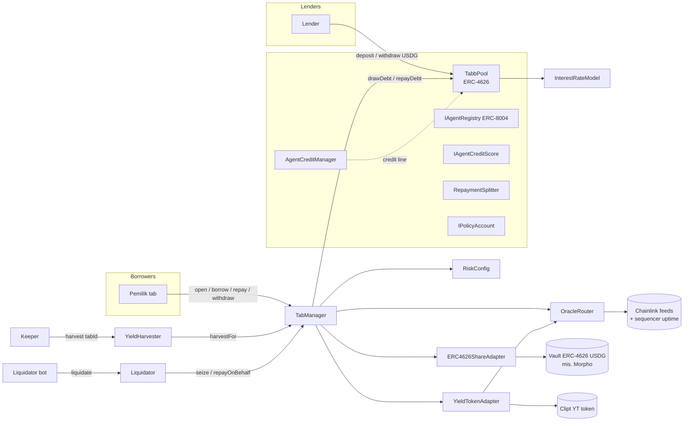
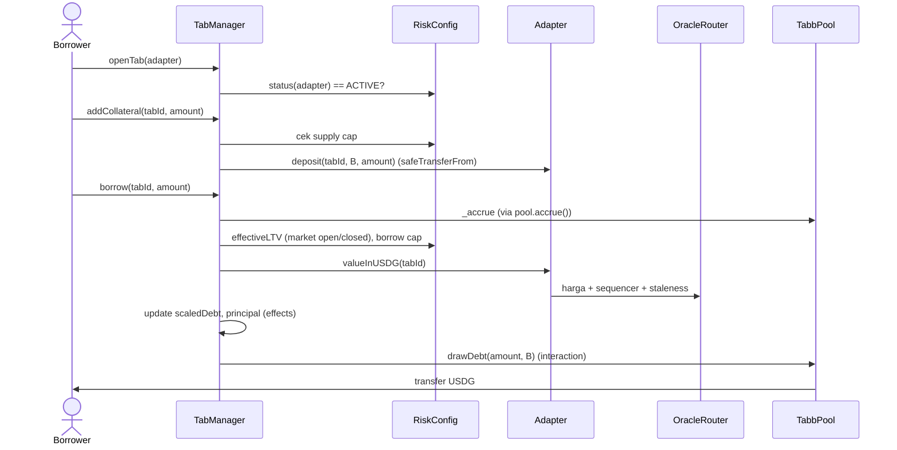
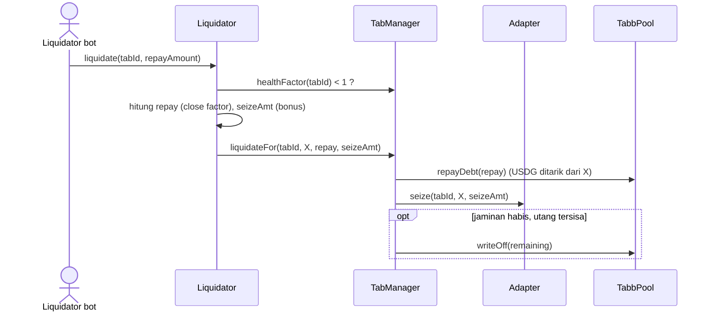
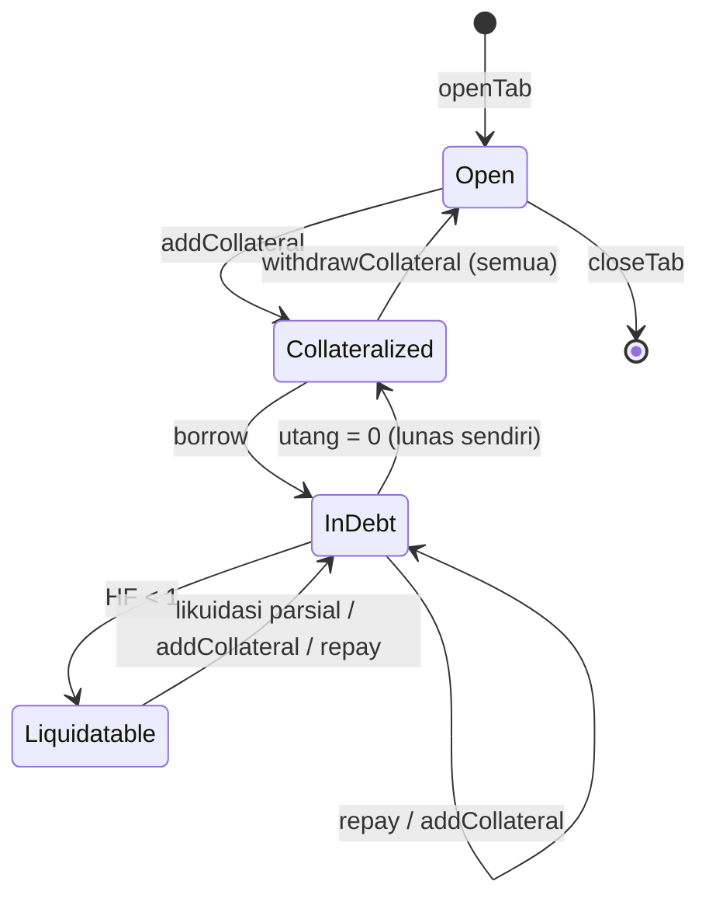
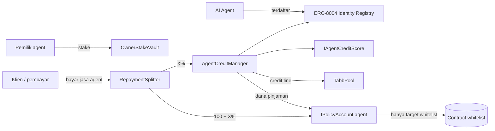

# Tabb — Design Document

> **Put it on the tab. Your yield pays it back.**
>
> Status: **DRAFT v0.1 — menunggu persetujuan** (Milestone 1)
> Chain target: Robinhood Chain (Arbitrum Orbit L2, chain ID `4663`)

---

## Daftar isi

1. [Ringkasan](#1-ringkasan)
2. [Tujuan dan non-tujuan](#2-tujuan-dan-non-tujuan)
3. [Arsitektur tingkat tinggi](#3-arsitektur-tingkat-tinggi)
4. [Daftar contract](#4-daftar-contract)
5. [Akuntansi dan matematika](#5-akuntansi-dan-matematika)
6. [Diagram alur](#6-diagram-alur)
7. [Parameter risiko awal](#7-parameter-risiko-awal)
8. [Oracle, market closed, dan sequencer](#8-oracle-market-closed-dan-sequencer)
9. [Admin, pause, dan governance](#9-admin-pause-dan-governance)
10. [Fase 2: kredit AI agent (interface + stub)](#10-fase-2-kredit-ai-agent-interface--stub)
11. [Keamanan dan mitigasi](#11-keamanan-dan-mitigasi)
12. [Strategi testing](#12-strategi-testing)
13. [Struktur repo dan konfigurasi](#13-struktur-repo-dan-konfigurasi)
14. [Frontend](#14-frontend)
15. [Alamat yang harus diisi (TODO)](#15-alamat-yang-harus-diisi-todo)
16. [Rencana milestone](#16-rencana-milestone)
17. [Pertanyaan terbuka](#17-pertanyaan-terbuka)

---

## 1. Ringkasan

Tabb adalah protokol kredit di mana pinjaman dibayar dari **arus pendapatan masa depan**.

- **Fase 1 — Yield-backed credit.** Pengguna menaruh aset penghasil yield (share vault ERC-4626 berbasis USDG, atau token YT dividen saham dari Clipt) sebagai jaminan, lalu meminjam USDG dari pool lender. Yield jaminan dipanen (harvest) oleh keeper dan otomatis dipakai melunasi bunga, lalu pokok. Pinjaman selalu **overcollateralized**; kalau nilai jaminan turun, posisi bisa dilikuidasi.
- **Fase 2 — Agent credit.** AI agent yang terdaftar di registry ERC-8004 bisa membuka tab kecil berbasis reputasi. Pendapatan agent wajib melewati `RepaymentSplitter` yang memotong X% untuk membayar utang. Di MVP hanya interface dan stub.

Prinsip desain:

1. **Pool tidak tahu soal jaminan.** `TabbPool` hanya meminjamkan ke *credit line* yang di-whitelist (Fase 1: `TabManager`; Fase 2: `AgentCreditManager`). Ini kunci modularitas.
2. **TabManager tidak tahu detail aset.** Semua logika per jenis aset (custody, valuasi, harvest) ada di *collateral adapter*.
3. **Konservatif secara default.** Pembulatan selalu menguntungkan protokol, harga oracle divalidasi ketat, dan aksi yang menambah risiko (borrow, withdraw) diblokir lebih dulu saat ada keraguan, sementara aksi yang mengurangi risiko (repay, addCollateral, harvest) tidak pernah dipause.

---

## 2. Tujuan dan non-tujuan

**Tujuan MVP (Fase 1)**

- Lender: deposit/withdraw USDG ke pool ERC-4626 dan menerima bunga.
- Borrower: satu tab per (pengguna, jenis jaminan); openTab, addCollateral, borrow, repay, withdrawCollateral, closeTab.
- Self-repaying: `harvest(tabId)` permissionless dengan reward keeper.
- Likuidasi parsial dengan close factor dan bonus.
- Mode "market closed" untuk jaminan terkait saham.
- Interface Fase 2 tersedia tanpa perlu merombak Fase 1.

**Non-tujuan MVP**

- Upgradeability (contract immutable; migrasi via deploy baru).
- Tranche senior/junior (struktur hook disiapkan, implementasi Fase 2).
- Tab yang bisa ditransfer (NFT).
- Swap otomatis hasil yield non-USDG.
- Deploy mainnet (dilakukan pemilik proyek setelah audit).

---

## 3. Arsitektur tingkat tinggi



Hubungan kepercayaan (siapa boleh memanggil siapa):

| Pemanggil | Target | Fungsi | Kontrol akses |
|---|---|---|---|
| `TabManager` | `TabbPool` | `drawDebt`, `repayDebt`, `writeOff` | whitelist credit line + cap |
| `TabManager` | Adapter | `deposit`, `withdraw`, `seize`, `harvest` | `onlyTabManager` |
| `YieldHarvester` | `TabManager` | `harvestFor` | `onlyHarvester` |
| `Liquidator` | `TabManager` | `liquidateFor` | `onlyLiquidator` |
| Siapa saja | `YieldHarvester` | `harvest(tabId)` | permissionless |
| Siapa saja | `Liquidator` | `liquidate(tabId, amount)` | permissionless (HF < 1) |
| Owner (→ Timelock) | semua | setter parameter, whitelist, unpause | `Ownable2Step` |
| Guardian | semua yang pausable | `pause*` | role `guardian` |

---

## 4. Daftar contract

### 4.1 Fase 1

| Contract | Tipe | Tanggung jawab utama |
|---|---|---|
| `TabbPool` | ERC-4626 (OZ v5), `ReentrancyGuard`, `Pausable` | Pool USDG lender. Menyimpan **borrow index global**, total scaled debt, dan scaled debt per credit line. `totalAssets() = cash + totalDebt − reserves`. Hook `ILossAbsorber` untuk tranche junior (Fase 2; `address(0)` di MVP). |
| `InterestRateModel` | stateless | Model kink: `borrowRate(utilization)`. Satu instance per pool, bisa diganti owner. |
| `TabManager` | core | Siklus hidup tab, pencatatan utang per tab (scaled debt + principal), cek LTV/HF, routing ke adapter dan pool, saldo kredit pemilik (kelebihan yield). |
| `RiskConfig` | storage parameter | Parameter per jenis jaminan (adapter): maxLTV, LT, bonus, supply cap, borrow cap, status (ACTIVE/FROZEN/DISABLED), parameter market closed, status pasar fallback. Parameter global: close factor, min debt, reward keeper. |
| `OracleRouter` | view + konfigurasi | Membaca Chainlink `AggregatorV3Interface` dengan cek staleness (heartbeat per feed, terpisah untuk market open/closed), harga ≤ 0, round tidak lengkap, sequencer uptime + grace period. Menyediakan harga YT ber-haircut berdasarkan sisa jatuh tempo. Menyediakan `isMarketOpen(asset)`. |
| `ICollateralAdapter` | interface | Abstraksi aset penghasil yield. |
| `ERC4626ShareAdapter` | adapter | Custody share vault USDG per tab. Yield = kenaikan nilai share di atas *high-water mark* per tab; harvest = redeem share senilai kelebihan itu menjadi USDG. |
| `YieldTokenAdapter` | adapter | Custody token YT Clipt per tab. Yield = dividen yang bisa di-claim; dibagi per tab dengan akumulator `dividendPerToken` (pola MasterChef). Valuasi via `OracleRouter` + haircut jatuh tempo. |
| `YieldHarvester` | keeper entrypoint | `harvest(tabId)` permissionless; membayar reward keeper (`rewardBps`, dibatasi `maxReward`) dari yield yang dipanen; sisanya ke TabManager untuk bayar bunga → pokok → kredit pemilik. Juga `harvestMany(tabIds[])`. |
| `Liquidator` | liquidation entrypoint | Likuidasi parsial: hitung jumlah maksimum (close factor), konversi ke jaminan + bonus, tarik USDG dari likuidator, kirim jaminan, tangani bad debt. |
| `TabbAccessControl` (abstract) | base | `Ownable2Step` + `guardian` + modifier pause. Dipakai semua contract stateful. |

### 4.2 Interface `ICollateralAdapter` (usulan)

Interface asli di brief (`valueInUSDG()`, `harvest()`, `pendingYield()`) diperluas dengan `tabId` karena adapter melakukan custody per tab:

```solidity
interface ICollateralAdapter {
    // --- metadata ---
    function asset() external view returns (address);          // token jaminan (share vault / YT)
    function usdg() external view returns (address);

    // --- view ---
    function balanceOf(uint256 tabId) external view returns (uint256);       // unit token jaminan
    function valueInUSDG(uint256 tabId) external view returns (uint256);     // nilai jaminan dalam unit USDG (sudah ber-haircut), round down
    function valueOfAmount(uint256 amount) external view returns (uint256);  // untuk preview/likuidasi
    function amountForValue(uint256 usdgValue) external view returns (uint256);
    function pendingYield(uint256 tabId) external view returns (uint256);    // USDG yang akan didapat dari harvest
    function isEquityLinked() external view returns (bool);                  // true → tunduk ke mode market closed

    // --- mutating (onlyTabManager) ---
    function deposit(uint256 tabId, address from, uint256 amount) external;
    function withdraw(uint256 tabId, address to, uint256 amount) external;
    function seize(uint256 tabId, address to, uint256 amount) external;      // likuidasi
    function harvest(uint256 tabId, address to) external returns (uint256 usdgOut);
}
```
Unit: lihat §5.1.

### 4.3 Fase 2 (interface + stub)

| Contract | Status MVP |
|---|---|
| `IAgentRegistry` | interface — adapter ke ERC-8004 Identity Registry (agentId → owner, agent wallet, domain/URI). |
| `IAgentCreditScore` | interface — `scoreOf(agentId)`, `creditLimitOf(agentId)`. |
| `IPolicyAccount` | interface — smart account yang hanya boleh `execute` ke target whitelist. |
| `ICreditLine` | interface — kontrak umum credit line ke `TabbPool` (dipakai juga oleh `TabManager`). |
| `RepaymentSplitter` | stub — struktur dan event, logika `distribute()` minimal, belum dipakai produksi. |
| `AgentCreditManager` | stub — semua fungsi mutating `revert NotImplemented()`. |
| `OwnerStakeVault` | stub — penampung stake pemilik agent (anti-sybil). |

---

## 5. Akuntansi dan matematika

### 5.1 Unit dan desimal

- USDG diasumsikan **6 desimal** (perlu diverifikasi di chain → `decimals()` dibaca saat deploy dan di-assert, tidak di-hardcode di logika).
- Semua nilai jaminan dan utang di `TabManager` dinyatakan dalam **unit USDG native** (desimal USDG) agar perbandingan langsung tanpa konversi.
- Harga oracle dinormalisasi ke **WAD (1e18)** di `OracleRouter`.
- Parameter persentase dalam **basis poin (bps, 10_000 = 100%)**.
- Index bunga dalam **RAY (1e27)**.

### 5.2 TabbPool (ERC-4626)

```
cash          = USDG.balanceOf(pool)                      (lihat catatan donasi, Q4)
totalDebt     = totalScaledDebt × borrowIndex / RAY       (dibulatkan ke atas)
reserves      = bagian bunga untuk treasury (reserveFactor)
totalAssets() = cash + totalDebt − reserves
utilization   = totalDebt / (cash + totalDebt − reserves)
```

- **Accrual**: setiap fungsi state-changing memanggil `_accrue()`:
  `borrowIndex ← borrowIndex × (1 + rate × Δt / YEAR)` (bunga linear per periode, compounding per interaksi — pola Aave/Compound).
  `reserves += interestAccrued × reserveFactor`.
- **Inflation attack**: override `_decimalsOffset()` → `6` (share 12 desimal untuk aset 6 desimal), ditambah **seed deposit** kecil ke `address(0xdead)` di script deploy. Pembulatan mengikuti OZ v5 (mint/redeem ke bawah untuk pengguna).
- **Donasi**: karena `cash` memakai `balanceOf`, donasi langsung menaikkan harga share — tidak merugikan lender (OZ offset membuat serangan tidak menguntungkan). Alternatif: tracking `cash` internal (lihat Pertanyaan terbuka Q4).
- **Likuiditas**: `maxWithdraw`/`maxRedeem` dibatasi `cash − reserves` (lender tidak bisa menarik USDG yang sedang dipinjam). Ini menjamin invariant "share tidak bisa ditarik melebihi nilai aset".
- **Credit line**:
  ```
  drawDebt(uint256 amount, address to) returns (uint256 scaledAdded)   // onlyCreditLine, cek cap
  repayDebt(uint256 amount)            returns (uint256 scaledRemoved) // tarik USDG dari credit line
  writeOff(uint256 amount)                                             // bad debt: kurangi scaled debt credit line; kerugian ditanggung lender (atau ILossAbsorber)
  ```
  Setiap credit line punya `debtCap` (USDG). `TabManager` menyimpan scaled debt per tab dengan index yang **sama** dari pool → Σ scaled debt tab = scaled debt credit line `TabManager` (dicek di invariant).
- **Tranche-ready**: `lossAbsorber` (Fase 2: kontrak junior tranche) dipanggil di `writeOff` sebelum kerugian dibebankan ke pool senior.

### 5.3 InterestRateModel (kink)

```
if U ≤ U_opt:  rate = base + slope1 × U / U_opt
else:          rate = base + slope1 + slope2 × (U − U_opt) / (1 − U_opt)
supplyRate     = rate × U × (1 − reserveFactor)
```

Usulan awal: `base = 0%`, `slope1 = 6%`, `U_opt = 80%`, `slope2 = 60%`, `reserveFactor = 10%` (lihat §7 dan Q1 soal ekonomi self-repaying).

### 5.4 Tab

```solidity
struct Tab {
    address owner;
    address adapter;          // jenis jaminan
    uint128 scaledDebt;       // utang / borrowIndex
    uint128 principal;        // pokok tersisa (untuk urutan "bunga dulu, lalu pokok")
    uint128 yieldRepaid;      // total yield yang sudah dipakai membayar (statistik UI)
    uint64  openedAt;
    bool    open;
}
mapping(uint256 => Tab) tabs;
mapping(address owner => mapping(address adapter => uint256 tabId)) tabOf; // 1 tab per (owner, adapter)
mapping(address owner => uint256) ownerCredit;  // kelebihan yield, bisa di-claim (pull pattern)
```

- `debt(tabId) = scaledDebt × borrowIndex / RAY` (round **up**).
- `accruedInterest = debt − principal` (≥ 0).
- Pembayaran (repay manual maupun harvest): kurangi bunga dulu, lalu `principal`.
- `collateralValue = adapter.valueInUSDG(tabId)` (round **down**, sudah termasuk haircut).
- `effectiveLTV = marketOpen || !equityLinked ? maxLTV : closedMarketLTV` (0 jika borrow dibekukan saat pasar tutup).
- **Borrow/withdraw diizinkan** jika `debtAfter ≤ collateralValueAfter × effectiveLTV` **dan** `debtAfter ≥ minDebt` atau `debtAfter == 0`.
- **Health factor**: `HF = collateralValue × LT / debt` (WAD). `debt == 0 → HF = ∞`.
- Karena `maxLTV < LT`, setiap posisi tepat setelah borrow/withdraw punya `HF ≥ LT / maxLTV > 1` (invariant).

### 5.5 Harvest (self-repaying)

```
usdgOut   = adapter.harvest(tabId, harvester)      // 0 jika belum ada yield
if usdgOut < minHarvest → revert (anti-dust)
reward    = min(usdgOut × rewardBps / 10_000, maxReward)     → ke msg.sender
toRepay   = min(usdgOut − reward, debt)
excess    = usdgOut − reward − toRepay             → ownerCredit[owner]
```

- Harvest **tidak pernah menambah utang**: accrual terjadi lalu utang hanya berkurang (invariant).
- **ERC4626ShareAdapter**: tiap tab menyimpan `principalAssets` (high-water mark dalam USDG). `yield = max(0, convertToAssets(shares) − principalAssets)`; harvest me-redeem share senilai `yield` sehingga nilai tersisa = `principalAssets`. Jika harga share turun, tidak ada yield (dan high-water mark tidak turun). `addCollateral`/`withdraw` menyesuaikan `principalAssets` secara proporsional.
- **YieldTokenAdapter**: adapter memegang YT seluruh tab, jadi claim dividen bersifat agregat. Pembagian per tab memakai akumulator:
  ```
  _checkpoint(): claimed = YT.claim();  accDividendPerToken += claimed × 1e18 / totalYTHeld
  pending(tab) = balance(tab) × accDividendPerToken / 1e18 − rewardDebt(tab)
  ```
  `_checkpoint()` dipanggil sebelum setiap perubahan saldo (deposit/withdraw/seize/harvest) agar atribusi benar.

### 5.6 Likuidasi

```
require HF < 1
maxRepay   = debt × closeFactor            (100% jika HF < fullLiquidationHF atau debt < dustDebt)
repay      = min(requested, maxRepay)
seizeValue = repay × (1 + bonus)
seizeAmt   = adapter.amountForValue(seizeValue), dibatasi saldo jaminan tab
jika jaminan habis dan masih ada utang → writeOff(sisa utang) ke pool (bad debt, event BadDebt)
```

- Likuidator membayar USDG, menerima jaminan **in-kind** (share vault / YT).
- Harvest otomatis sebelum likuidasi: tidak di MVP (likuidator bisa memanggil harvest dulu secara terpisah). Lihat Q7.

---

## 6. Diagram alur

### 6.1 Lender

```mermaid
sequenceDiagram
    actor L as Lender
    participant P as TabbPool
    L->>P: deposit(assets, receiver)
    P->>P: _accrue()
    P->>L: mint shares (round down)
    Note over P: Bunga dari borrower menaikkan totalAssets → harga share naik
    L->>P: redeem(shares)
    P->>P: _accrue(); cek shares ≤ maxRedeem (dibatasi cash)
    P->>L: transfer USDG
```

### 6.2 Buka tab dan borrow



### 6.3 Harvest

```mermaid
sequenceDiagram
    actor K as Keeper
    participant H as YieldHarvester
    participant TM as TabManager
    participant A as Adapter
    participant P as TabbPool
    K->>H: harvest(tabId)
    H->>TM: harvestFor(tabId, K)
    TM->>A: harvest(tabId, TM)
    A-->>TM: usdgOut
    TM->>K: reward
    TM->>TM: kurangi bunga → pokok; excess → ownerCredit
    TM->>P: repayDebt(toRepay)
```

### 6.4 Likuidasi



### 6.5 Siklus end-to-end (self-repaying)



---

## 7. Parameter risiko awal

Semua parameter bisa diubah owner (→ timelock). Nilai di bawah adalah usulan konservatif.

### 7.1 Per jenis jaminan

| Parameter | Share vault USDG (ERC-4626) | YT dividen saham (Clipt) |
|---|---|---|
| Max LTV | **80%** | **40%** |
| Liquidation threshold | **85%** | **50%** |
| Liquidation bonus | **5%** | **10%** |
| Supply cap (nilai USDG) | 1.000.000 *(usulan)* | 250.000 *(usulan)* |
| Borrow cap (USDG) | 500.000 *(usulan)* | 50.000 *(usulan)* |
| Equity-linked (market closed berlaku) | Tidak | **Ya** |
| LTV saat market closed | — | **25%** atau `0` = borrow dibekukan (Q3) |
| Haircut jatuh tempo | — | `base 10% + 10%/tahun sisa tenor`, maks 50% |
| Sisa tenor minimum untuk borrow | — | 30 hari |
| Batas kenaikan harga share per harvest | 2%/hari *(sanity check, Q5)* | — |

Catatan: syarat `maxLTV < LT` dan `LT × (1 + bonus) < 100%` divalidasi di setter `RiskConfig` (85% × 1,05 = 89,25%; 50% × 1,10 = 55%).

### 7.2 Global

| Parameter | Usulan |
|---|---|
| Close factor | 50% |
| Full liquidation jika HF < | 0,95 |
| Dust debt (likuidasi penuh di bawah ini) | 100 USDG |
| Min debt per tab | 10 USDG |
| Reward keeper harvest | 0,5% dari yield, maks 25 USDG |
| Min harvest | 1 USDG |
| Reserve factor | 10% |
| IRM | base 0%, slope1 6%, kink 80%, slope2 60% |
| Sequencer grace period | 3600 detik |
| Heartbeat oracle (market open / closed) | per feed; usulan 1 jam / 80 jam (akhir pekan + libur) |
| `_decimalsOffset` pool | 6 |
| Seed deposit pool | 1.000 USDG ke `0xdead` (testnet: dari deployer) |

### 7.3 Catatan ekonomi self-repaying

Agar tab benar-benar melunasi diri sendiri, yield jaminan harus melebihi bunga:
`yieldAPY × collateral > borrowAPR × debt` ⇔ `LTV < yieldAPY / borrowAPR`.
Dengan yield `y` (APY jaminan), bunga `r` dan LTV awal `L` (yield dipanen terus, nilai pokok jaminan tetap), waktu lunas ≈ `t = ln(1 / (1 − r·L / y)) / r`.

| Vault APY `y` | Borrow APR `r` | LTV awal | Estimasi lunas |
|---|---|---|---|
| 5% | 6% | 20% | ≈ 4,6 tahun |
| 5% | 6% | 50% | ≈ 15,3 tahun |
| 5% | 6% | ≥ 83% | tidak pernah lunas (bunga > yield) |

Ini menjadi informasi penting di UI ("estimasi tanggal lunas", plus peringatan jika `r·L ≥ y`) dan terkait pertanyaan terbuka Q1.

---

## 8. Oracle, market closed, dan sequencer

### 8.1 OracleRouter

```solidity
struct FeedConfig {
    AggregatorV3Interface feed;
    uint32 heartbeatOpen;     // detik
    uint32 heartbeatClosed;   // detik (dipakai saat market closed, hanya untuk likuidasi)
    uint8  decimals;
}
function getPrice(address asset, Purpose p) external view returns (uint256 priceWad);
// Purpose: BORROW (ketat) | LIQUIDATION (toleran saat market closed) | VIEW
```

Validasi tiap pembacaan:

1. Sequencer uptime feed: `answer == 0` (up) dan `block.timestamp − startedAt > gracePeriod`. Jika gagal → revert untuk BORROW; untuk LIQUIDATION selama grace period juga revert (memberi waktu pengguna menambah jaminan setelah sequencer pulih — pola Aave).
2. `answer > 0`.
3. `updatedAt != 0`, `answeredInRound ≥ roundId`.
4. `block.timestamp − updatedAt ≤ heartbeat` (open/closed tergantung status pasar dan purpose).
5. Opsional: batas min/max harga per feed (circuit breaker).

### 8.2 Valuasi

- **Share vault USDG**: `value = vault.convertToAssets(shares)` dalam USDG. Tidak butuh oracle harga karena utang juga USDG (risiko depeg USDG saling meniadakan). Perlindungan manipulasi: whitelist vault, sanity bound kenaikan harga share (Q5).
- **YT**: `value = balance × priceYT × (1 − haircut(ttm)) + pendingDividend`.
  - `priceYT` dari feed (sumber harga YT belum jelas → Q2).
  - `haircut(ttm) = min(maxHaircut, baseHaircut + annualHaircut × ttm / 365d)`. Tenor lebih panjang = ketidakpastian dividen lebih besar = diskon lebih besar.
  - `ttm < minTTM` → borrow baru ditolak (value tetap dihitung untuk HF/likuidasi).
  - Konversi USD → USDG: jika feed USDG/USD tersedia, `valueUSDG = valueUSD / max(1, priceUSDG)` (konservatif); jika tidak, asumsikan 1:1 (Q6).

### 8.3 Mode market closed

```
isMarketOpen(adapter):
    1. Jika RiskConfig.marketStatusFeed[adapter] di-set → baca feed (dengan cek staleness)
    2. Else → RiskConfig.manualMarketStatus[adapter] (di-set owner atau keeper ber-role MARKET_KEEPER)
```

Efek saat **closed** untuk jaminan equity-linked:

| Aksi | Efek |
|---|---|
| borrow | LTV = `closedMarketLTV`; jika `0` → revert `BorrowFrozenMarketClosed` |
| withdrawCollateral | cek memakai `closedMarketLTV` (mencegah tarik jaminan di harga stale) |
| repay / addCollateral / harvest | normal |
| likuidasi | **tetap berjalan**, memakai harga dengan `heartbeatClosed` |

Rasional: aksi yang menambah risiko dibatasi ketika harga tidak bisa dipercaya; aksi yang menurunkan risiko selalu boleh. Skenario stres milestone 4: harga YT turun 30% saat market closed → feed update → HF < 1 → likuidasi parsial berhasil, borrow baru tetap ditolak.

---

## 9. Admin, pause, dan governance

- **Owner**: `Ownable2Step`. Di MVP EOA/multisig deployer; disiapkan untuk ditransfer ke `TimelockController` (OZ) — tidak ada asumsi `owner == EOA` di kode.
- **Guardian**: alamat terpisah, hanya bisa **pause**. Unpause hanya owner.
- **Granularitas pause**:

| Contract | Bisa dipause | Tidak pernah dipause |
|---|---|---|
| TabbPool | deposit, withdraw/redeem (Q8), drawDebt | repayDebt |
| TabManager | openTab, borrow, withdrawCollateral | repay, addCollateral, claimCredit |
| YieldHarvester | harvest (hanya owner, mis. bug adapter) | — |
| Liquidator | liquidate (hanya owner, Q8) | — |
| RiskConfig | per-aset `FROZEN` (tidak ada aksi baru selain repay/likuidasi) / `DISABLED` | — |

- Setter parameter memvalidasi batas (mis. LTV ≤ 95%, bonus ≤ 20%, reserveFactor ≤ 50%) dan emit event.
- Tidak ada fungsi admin yang bisa memindahkan dana pengguna (kecuali `withdrawReserves` ke treasury, dibatasi `reserves`).

---

## 10. Fase 2: kredit AI agent (interface + stub)



- **IAgentRegistry**: `ownerOf(agentId)`, `agentWallet(agentId)`, `registeredAt(agentId)`, `exists(agentId)`. Diimplementasi sebagai adapter ke ERC-8004 (standar masih draft → interface sendiri, adapter tipis).
- **IAgentCreditScore**: input umur agent, volume pendapatan (diukur di `RepaymentSplitter`), riwayat bayar, stake pemilik → `scoreOf`, `creditLimitOf`.
- **RepaymentSplitter**: satu splitter per agent; semua pendapatan masuk ke sini; `distribute(token)` memotong `splitBps` untuk membayar utang, sisanya ke wallet agent. Splitter tidak bisa diganti agent selama ada utang.
- **IPolicyAccount**: `execute(target, data)` hanya jika `target` di-whitelist; dana pinjaman tidak bisa ditarik keluar langsung.
- **Anti-sybil**: stake wajib pemilik (slashable saat default), limit awal kecil (mis. 100 USDG), limit naik bertahap sesuai riwayat.
- **Modularitas terhadap Fase 1**: `AgentCreditManager` hanya perlu didaftarkan sebagai credit line baru di `TabbPool` (`setCreditLine(acm, cap)`); `TabManager` tidak berubah. Tranche junior dipasang lewat `setLossAbsorber`.

---

## 11. Keamanan dan mitigasi

| Risiko | Mitigasi |
|---|---|
| Reentrancy | `ReentrancyGuard` di semua entrypoint eksternal; checks-effects-interactions; adapter dipanggil setelah state utang diperbarui. |
| Token aneh (fee-on-transfer, return false, rebasing) | `SafeERC20`; whitelist aset; adapter mengukur saldo sebelum/sesudah transfer dan revert jika tidak cocok. |
| Inflation attack ERC-4626 | `_decimalsOffset = 6` + seed deposit. |
| Manipulasi harga share vault (donasi) | Whitelist vault, sanity bound kenaikan harga, high-water mark (Q5). |
| Oracle stale / ≤ 0 / sequencer down | §8.1. |
| Gap harga di luar jam bursa | Mode market closed (§8.3), LTV YT rendah, bonus besar. |
| Pembulatan | Utang round up, nilai jaminan round down, share mint round down, reward keeper round down. |
| Griefing harvest kecil | `minHarvest`; reward persentase sehingga tidak ada insentif memecah harvest. |
| Bad debt | `writeOff` + event; Fase 2 junior tranche menyerap kerugian dulu. |
| Likuidator tidak bisa menjual YT | Bonus 10%, borrow cap kecil, LTV rendah (Q9). |
| Admin key | Ownable2Step → timelock; guardian hanya pause; setter dibatasi. |
| Adapter berbahaya | Hanya owner yang mendaftarkan adapter di RiskConfig; adapter immutable. |
| Atribusi dividen YT salah | Checkpoint sebelum setiap perubahan saldo; invariant Σ pending ≤ saldo claimable. |

Detail lengkap di `docs/SECURITY.md` (milestone 7).

---

## 12. Strategi testing

**Mock**: `MockUSDG` (6 dec, mintable), `MockAggregator` (set answer/updatedAt/round), `MockSequencerFeed`, `MockERC4626Vault` (bisa "inject yield" dan menurunkan harga), `MockYieldToken` (dividen claimable, maturity), `MockFeeOnTransferToken` (negatif test).

**Unit test** per contract: semua jalur sukses + setiap revert (custom error).

**Fuzz test**: borrow/repay jumlah acak, harvest dengan yield acak, likuidasi dengan penurunan harga acak, deposit/withdraw lender acak.

**Invariant test** (handler-based, Foundry `invariant_`):

1. `pool.totalDebt() ≤ pool.totalAssets()` (total utang ≤ total aset pool).
2. Setelah setiap `borrow`/`withdrawCollateral` di handler: `HF(tab) ≥ 1` (ghost variable).
3. `pool.previewRedeem(totalSupply) ≤ totalAssets` dan `maxWithdraw(user) ≤ cash`; tidak ada lender yang bisa menarik lebih dari `convertToAssets(shares)`.
4. Setiap `harvest`: `debtAfter ≤ debtBefore` (setelah accrual).
5. Tambahan: `Σ tab.scaledDebt == pool.scaledDebtOf(TabManager)`; `Σ adapter.balanceOf(tab) == token.balanceOf(adapter)`.

**Skenario**:
- E2E: lender deposit → open tab → borrow → N kali harvest (vault yield disuntik) → utang 0 → withdraw semua jaminan → closeTab.
- Stres: YT tab di LTV 40%, market closed, harga turun 30% → borrow ditolak, HF < 1, likuidasi parsial (close factor) berhasil, bonus benar, sisa posisi sehat / bad debt tercatat jika relevan.

**Coverage**: `forge coverage` dengan target ≥ 90% untuk `TabManager`, `YieldHarvester`, `Liquidator` (dilaporkan per milestone).

---

## 13. Struktur repo dan konfigurasi

```
tabb/
├── contracts/                  # Foundry
│   ├── foundry.toml
│   ├── src/
│   │   ├── core/      TabbPool.sol, TabManager.sol, InterestRateModel.sol, RiskConfig.sol
│   │   ├── oracle/    OracleRouter.sol
│   │   ├── adapters/  ERC4626ShareAdapter.sol, YieldTokenAdapter.sol
│   │   ├── periphery/ YieldHarvester.sol, Liquidator.sol
│   │   ├── access/    TabbAccessControl.sol
│   │   ├── interfaces/ ICollateralAdapter.sol, ICreditLine.sol, IInterestRateModel.sol, IOracleRouter.sol, IClipYieldToken.sol, ...
│   │   ├── libraries/ TabbMath.sol, Errors.sol
│   │   └── phase2/    IAgentRegistry.sol, IAgentCreditScore.sol, IPolicyAccount.sol, RepaymentSplitter.sol, AgentCreditManager.sol, OwnerStakeVault.sol
│   ├── test/
│   │   ├── mocks/ unit/ fuzz/ invariant/ scenario/
│   └── script/
│       ├── Config.s.sol        # alamat per chain (TODO placeholder)
│       ├── DeployLocal.s.sol   # anvil: deploy mock + protokol + seed
│       └── DeployTestnet.s.sol # testnet saja; revert jika chainid == 4663 mainnet
├── web/                        # Next.js App Router + wagmi v2 + viem + Tailwind
├── config/
│   └── addresses.ts            # alamat per chain (TODO placeholder), dipakai web/
├── docs/  DESIGN.md, SECURITY.md
├── .env.example
└── .gitignore                  # termasuk .env
```

- **Env** (`.env.example`): `ROBINHOOD_RPC_URL`, `ROBINHOOD_TESTNET_RPC_URL`, `ANVIL_RPC_URL`, `DEPLOYER_PRIVATE_KEY` (hanya untuk testnet/anvil), `NEXT_PUBLIC_RPC_URL`, `NEXT_PUBLIC_CHAIN_ID`, `NEXT_PUBLIC_WALLETCONNECT_PROJECT_ID`.
- **Guard mainnet**: script deploy `require(block.chainid != 4663)`; tidak ada konfigurasi broadcast mainnet di repo.
- OpenZeppelin v5 via `forge install` (pinned), Solidity `^0.8.24` (compile dengan versi pinned di `foundry.toml`, mis. `0.8.24`/`0.8.26`), `via_ir` hanya bila perlu.

---

## 14. Frontend

| Halaman | Isi |
|---|---|
| **Lend** | Deposit/withdraw USDG; APY lender (supplyRate), utilisasi, TVL, likuiditas tersedia. |
| **Open a Tab** | Pilih jaminan → jumlah jaminan + jumlah pinjaman; LTV dan HF live (simulasi client-side dari `valueOfAmount` + parameter RiskConfig), badge market open/closed, estimasi tanggal lunas; **peringatan risiko wajib** (checkbox konfirmasi) sebelum borrow. |
| **My Tabs** | Daftar tab, sisa utang, bunga vs pokok, yield yang sudah melunasi, pending yield, estimasi tanggal lunas, HF; tombol harvest/repay/add/withdraw/claim credit/close. |
| **Liquidations** | Daftar tab dengan HF < 1,1 (diurutkan), jumlah maksimal yang bisa dilikuidasi, estimasi bonus; tombol liquidate. Data dari event `TabOpened` + multicall (tanpa indexer di MVP). |
| **Agents** | "Coming soon" + penjelasan Fase 2. |

Gaya: mobile-first, dark mode default, Tailwind, komponen sederhana tanpa library UI berat. Chain config Robinhood Chain (4663) + anvil (31337) dengan RPC dari env. Alamat contract dibaca dari `config/addresses.ts`.

---

## 15. Alamat yang harus diisi (TODO)

Semua masuk ke `config/addresses.ts` dan `contracts/script/Config.s.sol` sebagai `address(0)` dengan komentar `// TODO`. **Tidak ada alamat yang dikarang.**

| Item | Mainnet (4663) | Testnet | Catatan |
|---|---|---|---|
| USDG token | TODO | TODO | Verifikasi `decimals()` |
| Chainlink L2 Sequencer Uptime Feed | TODO | TODO | Jika tidak ada di Robinhood Chain → Q10 |
| Chainlink USDG/USD feed | TODO (opsional) | TODO | Q6 |
| Feed harga YT / saham underlying | TODO per YT | TODO | Q2 |
| Feed status market (jika ada) | TODO (opsional) | TODO | Fallback manual |
| Vault ERC-4626 USDG (mis. Morpho) | TODO per vault | TODO | Harus di-review sebelum whitelist |
| Token YT Clipt | TODO per seri | TODO | Interface claim → Q2 |
| ERC-8004 Identity Registry | TODO (Fase 2) | TODO | |
| Owner / Timelock | TODO | TODO | |
| Guardian | TODO | TODO | |
| Treasury (reserves) | TODO | TODO | |

Di anvil semua diganti dengan mock oleh `DeployLocal.s.sol`.

---

## 16. Rencana milestone

| # | Isi | Gate |
|---|---|---|
| 1 | `docs/DESIGN.md` | **Persetujuan Anda** |
| 2 | Scaffold monorepo, mock, `TabbPool`, `InterestRateModel` + test | Laporan test |
| 3 | `TabManager`, `RiskConfig`, `OracleRouter`, dua adapter + test | Laporan test |
| 4 | `YieldHarvester`, `Liquidator`, invariant, skenario E2E + stres, coverage | Laporan test + coverage |
| 5 | Interface dan stub Fase 2 | Laporan test |
| 6 | Frontend terhubung ke anvil + script deploy testnet | Laporan test + cara menjalankan |
| 7 | `docs/SECURITY.md` | Review |

---

## 17. Pertanyaan terbuka

Keputusan berikut **belum saya putuskan**; usulan default saya ditulis agar bisa langsung disetujui atau dikoreksi.

| # | Pertanyaan | Usulan default |
|---|---|---|
| **Q1** | **Ekonomi lender vs self-repaying.** Jika borrow APR < yield jaminan (syarat self-repaying), lender pool mendapat lebih kecil dari menaruh USDG langsung di vault yang sama. Apakah pool boleh menaruh cash menganggur ke vault ERC-4626 (strategi idle cash) untuk menaikkan APY lender? | MVP: tidak (risiko tambahan); IRM dibuat bisa diganti. Dicatat untuk Fase 2. |
| **Q2** | **Interface dan harga YT Clipt.** Bagaimana fungsi claim dividen (nama fungsi, token dividen — USDG atau lain?), apakah ada `maturity()`, dan dari mana harga YT (feed khusus YT, atau diturunkan dari harga saham × ekspektasi dividen)? | Saya definisikan `IClipYieldToken { claim(); claimable(address); maturity(); }`, dividen dalam USDG, harga dari satu feed Chainlink-compatible per YT. Adapter disesuaikan setelah spesifikasi Clipt tersedia. |
| **Q3** | Saat market closed untuk YT: turunkan LTV (25%) atau bekukan borrow total? | Bekukan (`closedMarketLTV = 0`) sebagai default; bisa diubah ke 25%. |
| **Q4** | Pool memakai `balanceOf` (donasi masuk ke lender) atau tracking cash internal? | `balanceOf` + offset; lebih sederhana dan donasi menguntungkan lender. |
| **Q5** | Proteksi manipulasi harga share vault: cukup whitelist, atau tambah batas kenaikan harga per periode (harvest/valuasi dibatasi)? | Whitelist + batas kenaikan untuk **valuasi borrow** (bukan untuk harvest). |
| **Q6** | Apakah USDG diasumsikan $1, atau perlu feed USDG/USD? Hanya relevan untuk YT (dinilai dalam USD). | Pakai feed jika ada; jika tidak, 1:1 dengan catatan risiko. |
| **Q7** | Apakah `liquidate()` otomatis memanggil harvest dulu (adil bagi borrower, tapi gas lebih mahal dan bisa gagal)? | Tidak; harvest terpisah, keeper didorong harvest posisi berisiko. |
| **Q8** | Boleh-kah guardian/owner mempause withdraw lender dan likuidasi? | Withdraw lender: pausable oleh guardian (insiden). Likuidasi: hanya owner, bukan guardian. |
| **Q9** | Likuidasi YT in-kind: siapa pembeli YT? Perlu likuidator internal/DEX route? | MVP in-kind saja + borrow cap kecil. |
| **Q10** | Apakah Robinhood Chain punya Chainlink Sequencer Uptime Feed? Jika tidak, apa fallback-nya? | Jika tidak ada: flag `sequencerCheckEnabled = false` + guardian pause manual; dicatat sebagai risiko. |
| **Q11** | Kelebihan yield setelah lunas: dikreditkan sebagai saldo claimable (pull) atau langsung dikirim ke pemilik? | Pull (`ownerCredit` + `claimCredit`) — lebih aman terhadap penerima yang revert. |
| **Q12** | Apakah tab perlu bisa ditransfer (NFT ERC-721) di masa depan? | Tidak di MVP; `owner` disimpan di struct sehingga bisa ditambah wrapper nanti. |
| **Q13** | Siapa yang boleh set status market manual: hanya owner, atau role keeper khusus? | Role `MARKET_KEEPER` yang di-set owner; keeper hanya bisa set *closed* ↔ *open*, tidak mengubah parameter. |
| **Q14** | Reward keeper dibayar dari yield (mengurangi pelunasan) atau dari reserves protokol? | Dari yield (0,5%, maks 25 USDG) — self-funding, tidak membebani lender. |
| **Q15** | Testnet mana yang dipakai (Robinhood Chain testnet tersedia? chain ID?) | Konfigurasi testnet sebagai TODO di `.env`/config; script menolak chain ID 4663. |
| **Q16** | Satu pool USDG untuk semua jaminan (risiko bersama) atau pool terisolasi per jaminan? | Satu pool + borrow cap per jaminan (MVP). |
