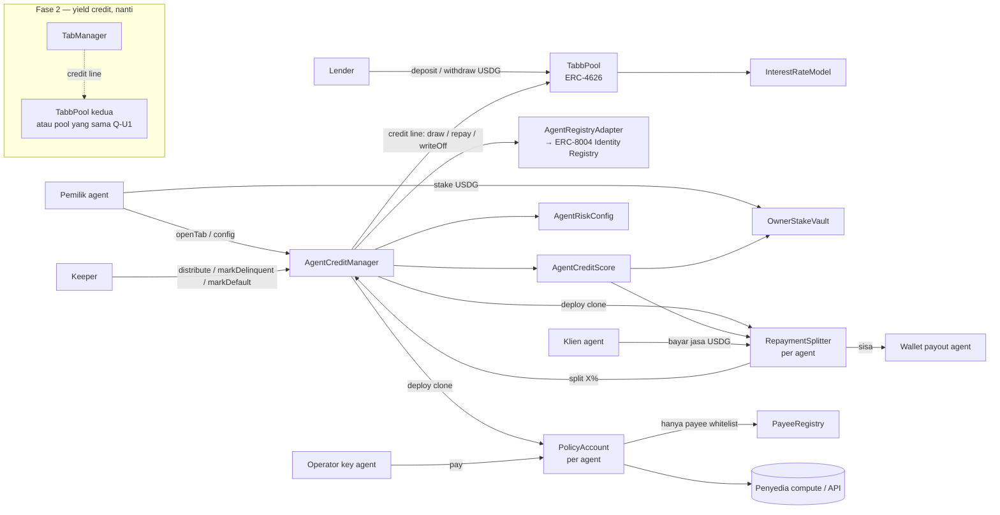
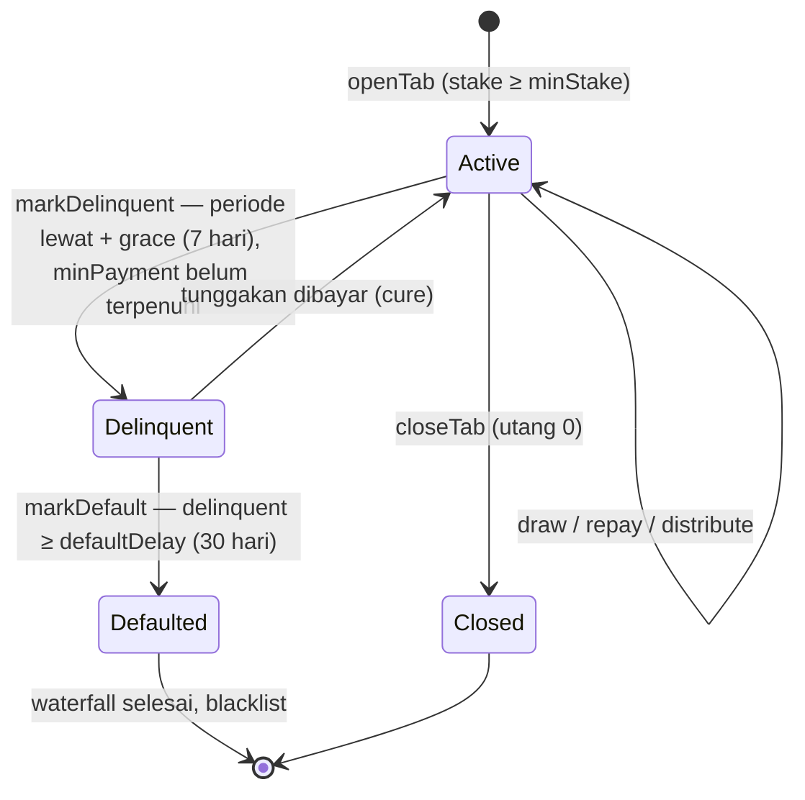
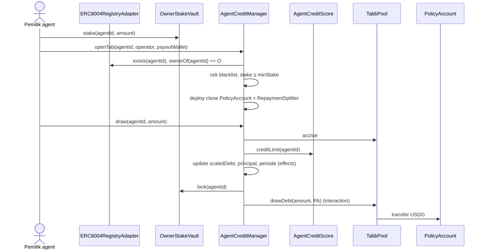
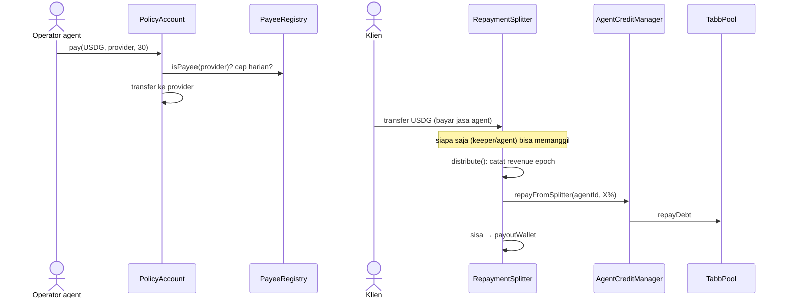
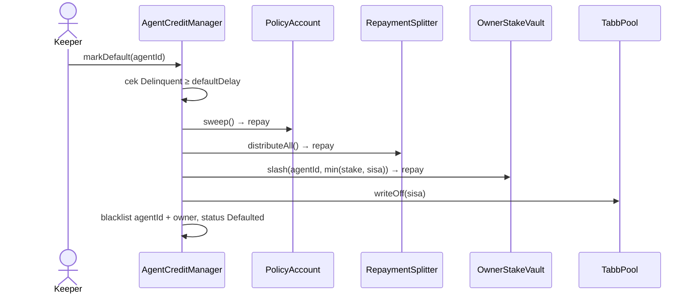

# Tabb — Design Document

> **Put it on the tab. Your yield pays it back.**
>
> Status: **v0.4 — disetujui; Fase 1 dan Fase 2 diimplementasikan (pra-audit)** (lihat §18 untuk catatan implementasi)
> Chain target: Robinhood Chain (Arbitrum Orbit L2, chain ID `4663`)

### Changelog

| Versi | Perubahan |
|---|---|
| v0.1 | Draft awal: Fase 1 = kredit berbasis yield, Fase 2 = kredit AI agent (stub). |
| v0.4 | Fase 2 (kredit berbasis yield) diimplementasikan penuh: TabManager, YieldRiskConfig, OracleRouter, dua adapter, YieldHarvester, Liquidator, pool terpisah (Q-U1). |
| v0.3 | Disetujui pemilik proyek (semua usulan default di §17 diterima). Catatan implementasi & penyimpangan kecil di §18. |
| v0.2 | **Urutan fase dibalik atas permintaan pemilik proyek.** Fase 1 = **kredit AI agent** (dirancang penuh). Fase 2 = **kredit berbasis yield** (desain v0.1 dipertahankan di §9, dibangun setelah Fase 1). `TabbPool` mendukung *spread* bunga per credit line. Milestone dan pertanyaan terbuka diperbarui. |

---

## Daftar isi

1. [Ringkasan](#1-ringkasan)
2. [Tujuan dan non-tujuan](#2-tujuan-dan-non-tujuan)
3. [Arsitektur tingkat tinggi](#3-arsitektur-tingkat-tinggi)
4. [Daftar contract](#4-daftar-contract)
5. [Fase 1 — Kredit AI agent (detail)](#5-fase-1--kredit-ai-agent-detail)
6. [Diagram alur Fase 1](#6-diagram-alur-fase-1)
7. [Parameter risiko awal Fase 1](#7-parameter-risiko-awal-fase-1)
8. [TabbPool dan InterestRateModel (bersama)](#8-tabbpool-dan-interestratemodel-bersama)
9. [Fase 2 — Kredit berbasis yield (desain, dibangun nanti)](#9-fase-2--kredit-berbasis-yield-desain-dibangun-nanti)
10. [Admin, pause, dan governance](#10-admin-pause-dan-governance)
11. [Keamanan dan mitigasi](#11-keamanan-dan-mitigasi)
12. [Strategi testing](#12-strategi-testing)
13. [Struktur repo dan konfigurasi](#13-struktur-repo-dan-konfigurasi)
14. [Frontend](#14-frontend)
15. [Alamat yang harus diisi (TODO)](#15-alamat-yang-harus-diisi-todo)
16. [Rencana milestone](#16-rencana-milestone)
17. [Pertanyaan terbuka](#17-pertanyaan-terbuka)

---

## 1. Ringkasan

Tabb adalah protokol kredit di mana pinjaman dibayar dari **arus pendapatan masa depan**.

- **Fase 1 — Agent credit (dibangun sekarang).** AI agent yang terdaftar di registry ERC-8004 bisa membuka *tab* kecil. Limitnya ditentukan oleh **stake pemilik**, **pendapatan yang terbukti lewat Tabb**, **umur**, dan **riwayat bayar**. Dana pinjaman tidak dikirim ke wallet bebas, tapi ke **PolicyAccount** yang hanya bisa membayar ke penerima yang di-whitelist. Semua pendapatan agent masuk lewat **RepaymentSplitter** yang otomatis memotong X% untuk melunasi utang.
- **Fase 2 — Yield-backed credit (dibangun setelahnya).** Pengguna menaruh aset penghasil yield sebagai jaminan dan meminjam USDG. Yield jaminan melunasi utang (self-repaying, overcollateralized). Desain v0.1 dipertahankan di §9.

Tagline tetap berlaku untuk keduanya: untuk agent, "yield" adalah pendapatan dari jasanya.

Prinsip desain:

1. **Pool tidak tahu siapa peminjamnya.** `TabbPool` (ERC-4626) hanya meminjamkan ke *credit line* yang di-whitelist dengan cap dan spread bunga masing-masing. Fase 1: `AgentCreditManager`. Fase 2: `TabManager`. Keduanya bisa ditambahkan tanpa mengubah pool.
2. **Kerugian maksimum per agent dibatasi dan bisa dihitung.** Kredit agent tidak dijamin aset penuh, jadi keamanannya datang dari: (a) stake pemilik sebagai *first loss*; (b) dana pinjaman yang tidak terpakai tetap terkunci di PolicyAccount dan bisa ditarik kembali; (c) limit kecil yang naik bertahap; (d) cap per agent, per pemilik, dan global.
3. **Konservatif secara default.** Aksi yang menambah risiko (draw, tarik stake) diblokir lebih dulu saat ada keraguan. Aksi yang mengurangi risiko (repay, distribute, tambah stake) tidak pernah dipause.

---

## 2. Tujuan dan non-tujuan

**Tujuan MVP (Fase 1)**

- Lender: deposit/withdraw USDG ke pool ERC-4626 dan menerima bunga (termasuk premi risiko agent).
- Pemilik agent: daftarkan agent (sudah terdaftar di ERC-8004) ke Tabb, setor stake, buka tab, lalu agent menarik dana (*draw*) ke PolicyAccount.
- Agent memakai dana hanya untuk membayar penerima yang di-whitelist (mis. penyedia compute/API/data).
- Pendapatan agent → RepaymentSplitter → X% melunasi utang, sisanya ke wallet payout agent.
- Status kredit: Active → Delinquent → Defaulted, dengan *waterfall* pemulihan dana yang deterministik.
- Skor dan limit kredit dihitung on-chain secara deterministik dan transparan.
- Struktur tetap siap untuk Fase 2 (kredit berbasis yield) tanpa merombak pool.

**Non-tujuan MVP**

- Upgradeability (contract immutable).
- Tranche senior/junior penuh (hook `ILossAbsorber` disiapkan).
- Full ERC-4337 smart account (PolicyAccount sederhana dengan *operator key*; kompatibilitas 4337 → Q-A12).
- Pendapatan dalam token selain USDG (Q-A5).
- Penagihan off-chain / recourse hukum.
- ~~Deploy mainnet.~~ Diubah 2026-11-25 atas instruksi pemilik: Fase 1 di-deploy ke mainnet lewat `DeployMainnet.s.sol` setelah review internal (`docs/AUDIT.md`). Fase 2 tetap belum di mainnet.

---

## 3. Arsitektur tingkat tinggi



Hubungan kepercayaan:

| Pemanggil | Target | Fungsi | Kontrol akses |
|---|---|---|---|
| `AgentCreditManager` | `TabbPool` | `drawDebt`, `repayDebt`, `writeOff` | whitelist credit line + cap |
| `AgentCreditManager` | `OwnerStakeVault` | `lock`, `unlock`, `slash` | `onlyManager` |
| `AgentCreditManager` | `PolicyAccount` | `sweep` (saat default/close) | `onlyManager` |
| `RepaymentSplitter` | `AgentCreditManager` | `repayFromSplitter` | hanya splitter milik agent tsb |
| Operator agent | `PolicyAccount` | `pay`, `execute` | `onlyOperator` + whitelist |
| Pemilik agent | `AgentCreditManager` | `openTab`, `draw`, `setOperator`, `setPayout`, `closeTab` | `ownerOf(agentId)` saat itu (lihat §5.1) |
| Siapa saja | `AgentCreditManager` | `repay`, `markDelinquent`, `markDefault` | permissionless, cek kondisi |
| Siapa saja | `RepaymentSplitter` | `distribute()` | permissionless |
| Owner (→ Timelock) | semua | parameter, whitelist payee, credit line, unpause | `Ownable2Step` |
| Guardian | semua yang pausable | `pause*` | role `guardian` |
| Payee curator | `PayeeRegistry` | tambah/hapus payee | role `PAYEE_CURATOR` (Q-A6) |

---

## 4. Daftar contract

### 4.1 Bersama (dipakai kedua fase)

| Contract | Tanggung jawab |
|---|---|
| `TabbPool` | ERC-4626 (OZ v5) untuk lender USDG. Menyimpan **index bunga per credit line** (rate = IRM(utilisasi) + `spreadBps` credit line). `totalAssets = cash + Σ debt credit line − reserves`. Hook `ILossAbsorber` untuk tranche junior nanti. |
| `InterestRateModel` | Model kink berdasarkan utilisasi. |
| `TabbAccessControl` (abstract) | `Ownable2Step` + `guardian` + modifier pause. |
| `ICreditLine` | Interface umum credit line (dipakai `AgentCreditManager` sekarang, `TabManager` nanti). |

### 4.2 Fase 1 — Agent credit

| Contract | Tipe | Tanggung jawab |
|---|---|---|
| `IAgentRegistry` | interface | Abstraksi identitas agent: `exists`, `ownerOf`, `agentWallet` (opsional). |
| `ERC8004RegistryAdapter` | adapter | Implementasi `IAgentRegistry` untuk ERC-8004 Identity Registry (ERC-721: `agentId = tokenId`). Interface standar masih bisa berubah, jadi semua ketergantungan dibatasi di adapter ini. |
| `OwnerStakeVault` | vault | Menyimpan stake USDG pemilik per `agentId`. Stake dikunci selama ada utang, ada *cooldown* sebelum bisa ditarik, dan bisa di-slash saat default. |
| `AgentCreditScore` | view + state ringan | Menghitung `creditLimit(agentId)` dan skor 0–1000 dari stake, pendapatan lewat splitter (jendela bergulir), umur di Tabb, dan riwayat siklus bayar. Juga menyimpan riwayat (siklus lunas, default) yang di-update manager. |
| `AgentRiskConfig` | storage parameter | Parameter global dan tier: min stake, base limit, leverage per tier, revenue advance, cap per agent/pemilik/global, split default/min, spread, jadwal pembayaran minimum, grace, default delay, batas belanja harian. |
| `AgentCreditManager` | core, credit line | Siklus hidup tab agent: `openTab`, `draw`, `repay`, `repayFromSplitter`, `markDelinquent`, `markDefault`, `closeTab`. Mencatat utang (scaled), pokok, periode pembayaran, status. Men-deploy clone PolicyAccount dan RepaymentSplitter (EIP-1167). |
| `PolicyAccount` | clone per agent | Menerima dana pinjaman. Operator agent hanya bisa `pay(token, payee, amount)` ke payee whitelist (dengan batas harian), atau `execute(target, data)` ke target + selector whitelist. Tidak ada transfer bebas. Manager bisa `sweep` saat default/close. |
| `PayeeRegistry` | whitelist global | Daftar payee (alamat penerima pembayaran) dan pasangan target+selector yang diizinkan untuk PolicyAccount. |
| `RepaymentSplitter` | clone per agent | Alamat pembayaran publik agent. `distribute()`: `splitBps` dari saldo USDG → `repayFromSplitter`; sisanya → wallet payout. Mencatat pendapatan per epoch untuk skor. Jika utang 0, 100% diteruskan ke payout. |

### 4.3 Fase 2 — Yield credit (desain di §9)

`TabManager`, `RiskConfig`, `OracleRouter`, `ICollateralAdapter`, `ERC4626ShareAdapter`, `YieldTokenAdapter`, `YieldHarvester`, `Liquidator`.

Di Fase 1 cukup interface-nya (`ICollateralAdapter`, `IOracleRouter`) dan stub `TabManager` yang mengimplementasi `ICreditLine` dengan fungsi mutating `revert NotImplemented()`. Ini membuktikan pool siap menerima credit line kedua.

---

## 5. Fase 1 — Kredit AI agent (detail)

### 5.1 Identitas dan kepemilikan

- Agent harus sudah terdaftar di ERC-8004 Identity Registry. `agentId` = tokenId ERC-721.
- **Satu tab per `agentId`.**
- Saat `openTab`, `ownerOf(agentId)` dicatat sebagai **borrower of record** (`tab.owner`). Stake milik alamat ini yang menjadi first loss.
- **Kalau NFT identitas berpindah tangan** saat utang > 0: draw langsung dibekukan (`ownerOf != tab.owner` → revert `OwnerChanged`). Pemilik lama tetap bertanggung jawab (stake-nya tetap terkunci). Pemilik baru bisa *take over* dengan setor stake ≥ requirement lalu memanggil `assumeTab` (Q-A2: alternatifnya NFT di-escrow ke manager).
- Umur agent diukur sebagai `firstSeenAt` di Tabb (waktu pertama stake/openTab). Waktu mint di ERC-8004 belum tentu bisa dibaca on-chain (Q-A1).
- `agentId` dan `owner` yang pernah default masuk **blacklist** dan tidak bisa membuka tab lagi.

### 5.2 Stake (anti-sybil dan first loss)

- Token stake: **USDG** (Q-A4). Stake per `agentId`, disetor oleh `tab.owner`.
- `minStake` wajib untuk membuka tab.
- Stake dikunci selama `debt > 0`. Setelah lunas, ada `stakeCooldown` (mis. 7 hari) sebelum stake bisa ditarik. Cooldown mencegah pola "lunas → tarik stake → draw lagi tanpa stake".
- Saat default: stake di-slash sebesar `min(stake, sisa utang)` dan dipakai melunasi pool. Sisanya (jika ada) kembali ke pemilik.
- **Batas kerugian lender per agent** = `creditLimit − stake − saldo PolicyAccount yang belum terpakai` (lihat §5.4). Tier awal memakai leverage 1,0× sehingga utang agent baru selalu ≤ stake.

### 5.3 Skor dan limit kredit

Semua dihitung on-chain di `AgentCreditScore` dan bisa dilihat siapa saja.

**Komponen:**

| Komponen | Sumber | Catatan |
|---|---|---|
| Stake | `OwnerStakeVault` | Batas keras melalui leverage. |
| Pendapatan | `RepaymentSplitter` (epoch 7 hari, jendela 90 hari) | Hanya pendapatan USDG yang melewati splitter yang dihitung. |
| Umur | `firstSeenAt` di Tabb | Syarat naik tier. |
| Riwayat bayar | `AgentCreditScore` | Jumlah **siklus lunas yang memenuhi syarat** dan catatan delinquent. |
| Reputasi ERC-8004 | — | Tidak dipakai di MVP karena feedback mudah dipalsukan (sybil). Lihat Q-A10. |

**Siklus lunas yang memenuhi syarat:** utang naik dari 0 lalu kembali ke 0, dengan durasi ≥ 7 hari, puncak utang ≥ 50 USDG, dan tidak pernah delinquent. Syarat ini mencegah pola "draw lalu langsung repay" untuk mendongkrak skor.

**Tier:**

| Tier | Syarat | Leverage stake |
|---|---|---|
| T0 | baru | 1,0× |
| T1 | ≥ 3 siklus lunas, umur ≥ 30 hari, 0 delinquent dalam 90 hari | 1,5× |
| T2 | ≥ 10 siklus lunas, umur ≥ 90 hari, 0 delinquent dalam 180 hari | 2,0× |

**Rumus limit:**

```
revenueLimit = revenue90d × revenueAdvanceBps / 10_000
capacity     = max(baseLimit, revenueLimit)
stakeLimit   = stake × leverage(tier)
creditLimit  = min(capacity, stakeLimit, maxPerAgent, sisa cap per pemilik, sisa cap global)
```

Skor 0–1000 hanya untuk tampilan (normalisasi tier + revenue + umur). Keputusan on-chain selalu memakai `creditLimit`.

### 5.4 Draw dan PolicyAccount

- `draw(agentId, amount)` hanya oleh `tab.owner`. Syarat: status `Active`, `debtAfter ≤ creditLimit`, `debtAfter ≥ minDebt`, tidak di-pause, dan pool punya likuiditas.
- USDG dikirim dari pool **ke PolicyAccount agent**, bukan ke pemilik.
- `PolicyAccount`:
  - `operator`: kunci yang dikendalikan agent (di-set pemilik; bisa sama dengan `agentWallet` ERC-8004).
  - `pay(token, payee, amount)`: `payee` harus ada di `PayeeRegistry`, dan total pengeluaran 24 jam ≤ `dailySpendCap`.
  - `execute(target, data)`: `target` dan `bytes4 selector` harus di-whitelist. **Token USDG tidak boleh menjadi `target`.** Semua transfer USDG wajib lewat `pay()` agar cek payee tidak bisa dilewati. `approve` hanya ke spender whitelist dengan jumlah persis.
  - `repay()`: siapa saja bisa mengembalikan saldo PolicyAccount ke pool.
  - `sweep()` (`onlyManager`): saat default atau closeTab, saldo dikembalikan untuk melunasi utang.
- **Konsekuensi:** dana yang belum dibelanjakan tetap bisa ditarik kembali, jadi berfungsi sebagai jaminan parsial.
- **Risiko kolusi payee:** pemilik bisa mendaftarkan alamatnya sendiri sebagai "penyedia". Karena itu whitelist dikurasi global oleh role `PAYEE_CURATOR` (bukan per-agent), dan cap harian membatasi kecepatan kebocoran (Q-A6).

### 5.5 RepaymentSplitter

- Satu splitter per agent, di-deploy saat `openTab`. Alamatnya dipublikasikan sebagai alamat pembayaran agent (mis. `payTo` di metadata ERC-8004 / x402, Q-A16).
- `distribute()` (permissionless):
  ```
  bal     = USDG.balanceOf(splitter)
  revenue[epoch] += bal                         // dicatat untuk skor
  if debt > 0:
      toRepay = min(bal × splitBps / 10_000, debt)   // dalam status Delinquent: splitBps = 100%
      manager.repayFromSplitter(agentId, toRepay)
  payout  = bal − toRepay → payoutWallet
  ```
- `splitBps` default 20%, minimal `minSplitBps` 10%. Pemilik boleh menaikkan, tapi tidak boleh menurunkan di bawah minimum selama utang > 0 (Q-A8).
- Token selain USDG yang masuk ke splitter: `rescueToken(token)` meneruskan 100% ke payout dan tidak dihitung sebagai pendapatan (Q-A5).
- **Keterbatasan mendasar:** protokol tidak bisa memaksa klien membayar ke splitter. Mitigasinya: limit hanya tumbuh dari pendapatan yang lewat splitter, ada pembayaran minimum per periode (§5.7), dan stake menjadi first loss.
- **Pendapatan palsu (wash revenue):** pemilik bisa membayar agent-nya sendiri lewat splitter. Dampaknya dibatasi `stakeLimit`, karena pendapatan tinggi tetap tidak bisa menaikkan limit melewati `stake × leverage`. Opsi tambahan: fee protokol kecil pada setiap distribute (Q-A9).

### 5.6 Bunga

- `TabbPool` menyimpan index per credit line: `rate_line = IRM(U) + spreadBps_line`.
- `AgentCreditManager` menyimpan `scaledDebt` per agent dengan index milik credit line-nya. Σ scaled debt agent = scaled debt credit line (invariant).
- Spread agent default **+8% APR** (premi risiko kredit tanpa jaminan penuh, dibayar ke lender). `reserveFactor` dari bunga masuk ke reserve, yang juga menjadi lapisan asuransi di waterfall default.
- Origination fee: 0 di MVP (Q-A11).
- Pembayaran (repay manual, splitter, sweep, slash) melunasi **bunga dulu, lalu pokok**.

### 5.7 Pembayaran minimum, delinquency, dan default

Setiap tab punya periode pembayaran `paymentPeriod` (30 hari) yang dimulai dari draw pertama setelah utang 0.

```
minPaymentDue(period) = bunga yang terakumulasi di periode itu
                      + minPrincipalBps × pokok di awal periode     (mis. 10%)
```

Status:



- **Delinquent:** draw dibekukan, `splitBps` efektif 100%, PolicyAccount dibekukan (operator tidak bisa `pay`), dan dicatat di riwayat skor.
- **Defaulted** (`markDefault` permissionless setelah `defaultDelay`), **waterfall pemulihan**:
  1. `sweep` saldo USDG PolicyAccount → repay.
  2. `distribute` saldo splitter (100%) → repay.
  3. Slash stake pemilik → repay.
  4. Sisa utang → `pool.writeOff(sisa)`. Kerugian diserap `ILossAbsorber` (nanti), lalu reserve pool, lalu lender (harga share turun).
  5. Blacklist `agentId` dan `owner`; status final.
- Setelah default, splitter tetap ada. Kalau ada pendapatan yang masuk belakangan, `distribute()` mengirimnya ke pool sebagai *recovery* (memulihkan sebagian kerugian lender). Lihat Q-A14.

---

## 6. Diagram alur Fase 1

### 6.1 Lender

```mermaid
sequenceDiagram
    actor L as Lender
    participant P as TabbPool
    L->>P: deposit(assets, receiver)
    P->>P: _accrue() semua credit line
    P->>L: mint shares (round down)
    Note over P: Bunga + spread agent → totalAssets naik → harga share naik
    L->>P: redeem(shares)
    P->>P: _accrue(); shares ≤ maxRedeem (dibatasi cash)
    P->>L: transfer USDG
```

### 6.2 Onboarding agent dan draw



### 6.3 Belanja dan pelunasan dari pendapatan



### 6.4 Default



---

## 7. Parameter risiko awal Fase 1

Semua bisa diubah owner (→ timelock). Usulan konservatif:

| Parameter | Usulan |
|---|---|
| `minStake` | 100 USDG |
| `baseLimit` | 100 USDG |
| Leverage T0 / T1 / T2 | 1,0× / 1,5× / 2,0× |
| `revenueAdvanceBps` | 25% dari pendapatan 90 hari |
| `maxPerAgent` | 1.000 USDG |
| `maxPerOwner` (semua agent milik satu alamat) | 3.000 USDG |
| Cap global credit line agent (di pool) | 50.000 USDG |
| `minDebt` | 10 USDG |
| `splitBps` default / minimum | 20% / 10% (100% saat delinquent) |
| Spread agent | +8% APR di atas IRM |
| Origination fee | 0 |
| `paymentPeriod` | 30 hari |
| `minPrincipalBps` per periode | 10% |
| Grace sebelum delinquent | 7 hari |
| `defaultDelay` (delinquent → default) | 30 hari |
| `stakeCooldown` setelah lunas | 7 hari |
| `dailySpendCap` PolicyAccount | 25% dari creditLimit per 24 jam |
| Epoch pendapatan / jendela | 7 hari / 90 hari |
| Syarat siklus lunas | durasi ≥ 7 hari, puncak ≥ 50 USDG, tanpa delinquent |
| Reserve factor | 10% |
| IRM | base 0%, slope1 6%, kink 80%, slope2 60% |
| `_decimalsOffset` pool | 6 |
| Seed deposit pool | 1.000 USDG ke `0xdead` |

**Batas validasi setter:** leverage ≤ 5×, `minSplitBps` ≥ 5%, spread ≤ 50%, `defaultDelay` ≥ 7 hari, dan setiap cap ≤ cap global.

**Eksposur maksimum lender** (parameter awal): per agent T0 = 0 (utang ≤ stake); per agent T2 ≤ 1.000 − 500 = 500 USDG; global ≤ cap 50.000 dikurangi total stake.

---

## 8. TabbPool dan InterestRateModel (bersama)

### 8.1 Unit dan desimal

- USDG diasumsikan **6 desimal**. Nilai `decimals()` dibaca dan di-assert saat deploy, tidak di-hardcode di logika.
- Nilai uang dalam unit USDG native. Persentase dalam bps (10_000 = 100%). Index bunga dalam RAY (1e27). Harga (Fase 2) dalam WAD.

### 8.2 TabbPool

```
cash            = USDG.balanceOf(pool)                     (Q-U2)
debt(line)      = scaledDebt[line] × index[line] / RAY     (round up)
totalDebt       = Σ debt(line)
totalAssets()   = cash + totalDebt − reserves
U               = totalDebt / (cash + totalDebt − reserves)
rate(line)      = IRM.borrowRate(U) + spreadBps[line]
```

- `_accrue()` memperbarui index semua credit line (jumlah credit line kecil dan dibatasi, maks 8). `reserves += interest × reserveFactor`.
- **Inflation attack:** `_decimalsOffset() = 6` + seed deposit. Pembulatan mengikuti OZ v5.
- **Likuiditas:** `maxWithdraw`/`maxRedeem` dibatasi `cash − reserves`.
- **API credit line:**
  ```solidity
  function drawDebt(uint256 amount, address to) external returns (uint256 scaledAdded);   // onlyCreditLine, cek cap
  function repayDebt(uint256 amount) external returns (uint256 scaledRemoved);           // tarik USDG dari credit line
  function writeOff(uint256 amount) external;                                            // bad debt
  function debtOf(address line) external view returns (uint256);
  function indexOf(address line) external view returns (uint256);
  ```
- `writeOff`: panggil `lossAbsorber` (jika ada) → pakai `reserves` → sisanya mengurangi `totalAssets` (lender).
- Owner: `setCreditLine(line, cap, spreadBps)`, `setLossAbsorber`, `setInterestRateModel`, `setReserveFactor`, `withdrawReserves(to, amount)`.

### 8.3 InterestRateModel (kink)

```
if U ≤ U_opt:  rate = base + slope1 × U / U_opt
else:          rate = base + slope1 + slope2 × (U − U_opt) / (1 − U_opt)
supplyRate    ≈ Σ_line (rate_line × debt_line) / totalAssets × (1 − reserveFactor)
```

---

## 9. Fase 2 — Kredit berbasis yield (desain, dibangun nanti)

Desain dari v0.1, dipertahankan agar nanti tinggal dibangun. Di Fase 1 hanya interface dan stub (§4.3).

### 9.1 Contract

| Contract | Tanggung jawab |
|---|---|
| `TabManager` | Credit line kedua. openTab, addCollateral, borrow, repay, withdrawCollateral, closeTab. Satu tab per (pengguna, jenis jaminan). Utang scaled + principal; kelebihan yield → `ownerCredit` (pull). |
| `RiskConfig` | Per jaminan: maxLTV, LT, bonus, supply/borrow cap, status ACTIVE/FROZEN/DISABLED, parameter market closed, status pasar manual. Global: close factor, dust, reward keeper. |
| `OracleRouter` | Chainlink: cek staleness (heartbeat open/closed), harga ≤ 0, round, sequencer uptime + grace. Harga YT ber-haircut jatuh tempo. `isMarketOpen`. |
| `ICollateralAdapter` | `asset`, `balanceOf(tabId)`, `valueInUSDG(tabId)`, `valueOfAmount`, `amountForValue`, `pendingYield(tabId)`, `isEquityLinked`, `deposit/withdraw/seize/harvest` (onlyTabManager). |
| `ERC4626ShareAdapter` | Custody share vault USDG per tab. Yield = kenaikan di atas high-water mark `principalAssets`; harvest = redeem kelebihannya. |
| `YieldTokenAdapter` | Custody YT Clipt per tab. Dividen dibagi dengan akumulator `accDividendPerToken` + checkpoint sebelum setiap perubahan saldo. |
| `YieldHarvester` | `harvest(tabId)` permissionless. Reward keeper `min(yield × rewardBps, maxReward)`, lalu bayar bunga → pokok → kredit pemilik. |
| `Liquidator` | Likuidasi parsial jika HF < 1. Close factor 50% (100% jika HF < 0,95 atau dust). Seize in-kind + bonus. Bad debt → `writeOff`. |

### 9.2 Rumus inti

```
debt          = scaledDebt × index / RAY                (round up)
value         = adapter.valueInUSDG(tabId)              (round down, sudah ber-haircut)
effectiveLTV  = (marketOpen || !equityLinked) ? maxLTV : closedMarketLTV
borrow/withdraw OK jika debtAfter ≤ valueAfter × effectiveLTV
HF            = value × LT / debt
YT value      = bal × priceYT × (1 − haircut(ttm)) + pendingDividend
haircut(ttm)  = min(maxHaircut, baseHaircut + annualHaircut × ttm / 365d)
```

### 9.3 Parameter awal

| Parameter | Share vault USDG | YT dividen saham (Clipt) |
|---|---|---|
| Max LTV / LT / bonus | 80% / 85% / 5% | 40% / 50% / 10% |
| Supply cap / borrow cap | 1.000.000 / 500.000 | 250.000 / 50.000 |
| Market closed | tidak berlaku | LTV 25% atau borrow dibekukan (Q-Y3) |
| Haircut jatuh tempo | — | 10% + 10%/tahun, maks 50%; borrow ditolak jika ttm < 30 hari |

Global: close factor 50%, full liquidation jika HF < 0,95, dust 100 USDG, reward keeper 0,5% (maks 25 USDG), min harvest 1 USDG, grace sequencer 3600 detik, heartbeat 1 jam (open) / 80 jam (closed).

### 9.4 Market closed

Status dibaca dari feed oracle jika ada, kalau tidak dari flag manual (role `MARKET_KEEPER`). Saat closed, untuk jaminan equity-linked: borrow dan withdrawCollateral memakai `closedMarketLTV` (0 = beku). Repay, addCollateral, dan harvest tetap normal. **Likuidasi tetap berjalan** dengan heartbeat closed.

### 9.5 Ekonomi self-repaying

Waktu lunas ≈ `ln(1 / (1 − r·L / y)) / r`. Contoh: yield 5%, bunga 6% → LTV 20% ≈ 4,6 tahun; LTV 50% ≈ 15,3 tahun; LTV ≥ 83% tidak pernah lunas.

---

## 10. Admin, pause, dan governance

- **Owner:** `Ownable2Step`, disiapkan untuk ditransfer ke `TimelockController`.
- **Guardian:** hanya pause. Unpause hanya owner.
- **Role tambahan:** `PAYEE_CURATOR` (Fase 1), `MARKET_KEEPER` (Fase 2). Keduanya di-set owner.

| Contract | Bisa dipause | Tidak pernah dipause |
|---|---|---|
| TabbPool | deposit, withdraw/redeem (Q-U3), drawDebt | repayDebt |
| AgentCreditManager | openTab, draw | repay, repayFromSplitter, markDelinquent, markDefault |
| PolicyAccount (global flag di PayeeRegistry) | pay, execute | repay ke pool, sweep |
| RepaymentSplitter | — | distribute |
| OwnerStakeVault | withdraw stake | stake, slash |

- Tidak ada fungsi admin yang bisa memindahkan dana pengguna, kecuali `withdrawReserves` (dibatasi `reserves`) dan `slash` (hanya lewat `markDefault` yang syaratnya bisa dicek siapa saja).

---

## 11. Keamanan dan mitigasi

| Risiko | Mitigasi |
|---|---|
| Reentrancy | `ReentrancyGuard`, checks-effects-interactions; panggilan ke clone/pool setelah state diperbarui. |
| Token aneh | `SafeERC20`; hanya USDG yang dihitung; cek saldo sebelum/sesudah transfer. |
| Inflation attack ERC-4626 | `_decimalsOffset = 6` + seed deposit. |
| Sybil (banyak agent, banyak pemilik) | Stake wajib per agent, leverage T0 1,0×, cap per pemilik dan global, blacklist. Sybil dengan banyak alamat pemilik tetap dibatasi stake per agent. |
| Wash revenue | Limit dibatasi `stake × leverage`; siklus lunas punya syarat durasi/jumlah; opsi fee distribute (Q-A9). |
| Pendapatan tidak lewat splitter | Pembayaran minimum per periode → delinquent → default + slash. |
| Kebocoran dana PolicyAccount | Payee whitelist global, cap harian, larangan `execute` ke token USDG, approve persis. |
| Kolusi payee | Kurasi oleh `PAYEE_CURATOR`, cap harian, eksposur dibatasi stake. |
| NFT identitas dipindah | Draw beku jika `ownerOf != tab.owner`; stake pemilik lama tetap terkunci. |
| Kunci operator agent bocor | Penyerang hanya bisa membayar ke payee whitelist (dibatasi cap harian). Pemilik bisa `setOperator` untuk rotasi. |
| Pembulatan | Utang round up, limit/nilai round down, share round down. |
| Griefing `markDelinquent`/`markDefault` | Syarat waktu dihitung deterministik on-chain dan tidak bisa dipicu lebih awal. |
| Admin key | Ownable2Step → timelock; guardian hanya pause; setter dibatasi. |
| Ketergantungan ERC-8004 (standar masih bisa berubah) | Diisolasi di `ERC8004RegistryAdapter`; adapter immutable, diganti via setter owner hanya untuk tab baru. |

Detail lengkap di `docs/SECURITY.md` (milestone 7).

---

## 12. Strategi testing

**Mock:** `MockUSDG` (6 dec), `MockERC8004IdentityRegistry` (ERC-721 dengan transfer), `MockPayee`, `MockFeeOnTransferToken`. Untuk Fase 2 nanti: `MockAggregator`, `MockSequencerFeed`, `MockERC4626Vault`, `MockYieldToken`.

**Unit test** per contract: semua jalur sukses dan setiap custom error.

**Fuzz test:** draw/repay jumlah acak; distribute dengan pendapatan dan `splitBps` acak; perhitungan limit (stake, revenue, tier acak); transisi waktu delinquency/default; deposit/withdraw lender.

**Invariant test** (handler-based):

1. `pool.totalDebt() ≤ pool.totalAssets()`.
2. Tepat setelah `draw`: `debt(agent) ≤ creditLimit(agent)`, dan Σ utang agent milik satu pemilik ≤ `maxPerOwner`.
3. Lender tidak bisa menarik melebihi `convertToAssets(shares)`, dan `maxWithdraw ≤ cash − reserves`.
4. `distribute()` dan `repay` tidak pernah menambah utang.
5. `Σ agent.scaledDebt == pool.scaledDebt(AgentCreditManager)`.
6. Dana PolicyAccount hanya keluar ke payee whitelist, ke pool (repay/sweep), atau tidak sama sekali (handler mencoba `execute` sembarang).
7. Stake tidak bisa ditarik selama `debt > 0` atau dalam cooldown.
8. Setelah `markDefault`: utang agent = 0, dan `writeOff == utang − (sweep + splitter + slash)`.

**Skenario:**
- **E2E:** lender deposit → pemilik stake → openTab → draw → agent membayar payee → klien membayar splitter → beberapa kali distribute → utang lunas → siklus memenuhi syarat → tier naik → limit naik → tarik stake setelah cooldown.
- **Stres:** (a) agent berhenti bayar → delinquent → default → waterfall benar, dan turunnya harga share lender = kerugian bersih persis. (b) 10 agent milik satu pemilik default bersamaan → kerugian ≤ cap per pemilik − stake. (c) NFT identitas dipindah saat utang > 0 → draw ditolak, default tetap mengenai stake pemilik lama. (d) Kunci operator dicuri → kebocoran ≤ cap harian ke payee whitelist saja.

**Coverage:** target ≥ 90% untuk `AgentCreditManager`, `RepaymentSplitter`, `PolicyAccount`, dan `AgentCreditScore` (Fase 2 nanti: `TabManager`, `YieldHarvester`, `Liquidator`).

---

## 13. Struktur repo dan konfigurasi

```
tabb/
├── contracts/                     # Foundry, Solidity ^0.8.24, OZ v5
│   ├── src/
│   │   ├── pool/        TabbPool.sol, InterestRateModel.sol
│   │   ├── agent/       AgentCreditManager.sol, AgentCreditScore.sol, AgentRiskConfig.sol,
│   │   │                OwnerStakeVault.sol, PolicyAccount.sol, PayeeRegistry.sol,
│   │   │                RepaymentSplitter.sol, ERC8004RegistryAdapter.sol
│   │   ├── yield/       TabManager.sol (stub Fase 2)
│   │   ├── access/      TabbAccessControl.sol
│   │   ├── interfaces/  ICreditLine, IAgentRegistry, IAgentCreditScore, IPolicyAccount,
│   │   │                IRepaymentSplitter, ICollateralAdapter, IOracleRouter, ...
│   │   └── libraries/   TabbMath.sol, Errors.sol
│   ├── test/  mocks/ unit/ fuzz/ invariant/ scenario/
│   └── script/
│       ├── Config.s.sol           # alamat per chain (placeholder TODO)
│       ├── DeployLocal.s.sol      # anvil: mock + protokol + data contoh
│       └── DeployTestnet.s.sol    # revert jika chainid == 4663
├── web/                           # Next.js App Router, TS, wagmi v2 + viem, Tailwind
├── config/addresses.ts            # placeholder TODO
├── docs/  DESIGN.md, SECURITY.md
├── .env.example
└── .gitignore                     # termasuk .env
```

- **Env:** `ROBINHOOD_RPC_URL`, `ROBINHOOD_TESTNET_RPC_URL`, `ANVIL_RPC_URL`, `DEPLOYER_PRIVATE_KEY` (hanya anvil/testnet), `NEXT_PUBLIC_RPC_URL`, `NEXT_PUBLIC_CHAIN_ID`, `NEXT_PUBLIC_WALLETCONNECT_PROJECT_ID`.
- **Guard mainnet:** `DeployLocal`/`DeployTestnet` menolak chain 4663. Mainnet hanya lewat `DeployMainnet.s.sol` (wajib `TABB_OWNER` ≠ deployer; ownership via Ownable2Step).

---

## 14. Frontend

| Halaman | Isi |
|---|---|
| **Lend** | Deposit/withdraw USDG; APY lender, utilisasi, TVL, likuiditas tersedia, **total eksposur kredit agent dan reserve** (pengungkapan risiko: kredit agent tidak dijamin aset penuh). |
| **Agents** | Hubungkan wallet → daftar `agentId` milik pengguna (dari registry) → setor stake → preview limit, tier, dan skor → buka tab → draw. **Peringatan risiko wajib** (checkbox) sebelum draw: stake bisa di-slash, aturan pembayaran minimum, dan waktu delinquency/default. |
| **My Agent Tabs** | Utang (bunga vs pokok), limit, tier dan rincian skor, jatuh tempo pembayaran minimum berikutnya, alamat splitter (salin/QR untuk dibagikan ke klien), saldo PolicyAccount, pendapatan 90 hari, yield yang sudah melunasi. Tombol: repay, distribute, draw, set operator/payout/split, tarik stake, close. |
| **Risk monitor** | Daftar tab yang mendekati jatuh tempo, delinquent, atau siap default. Tombol `markDelinquent` / `markDefault` untuk keeper. |
| **Yield Tab** | "Coming soon" (Fase 2). |

Gaya: mobile-first, dark mode default, Tailwind. Chain: Robinhood Chain (4663) + anvil (31337), RPC dari env. Data dari event + multicall (tanpa indexer di MVP).

---

## 15. Alamat yang harus diisi (TODO)

Semua di `config/addresses.ts` dan `contracts/script/Config.s.sol` sebagai `address(0)` + `// TODO`. **Tidak ada alamat yang dikarang.**

| Item | Fase | Catatan |
|---|---|---|
| USDG token (mainnet/testnet) | 1 | Verifikasi `decimals()` |
| ERC-8004 Identity Registry | 1 | Versi dan interface harus diverifikasi (Q-A1) |
| ERC-8004 Reputation Registry | 1 (opsional) | Tidak dipakai di skor MVP |
| Payee awal (penyedia compute/API) | 1 | Daftar dari Anda (Q-A6) |
| Owner / Timelock, Guardian, Treasury, Payee curator | 1 | |
| Chainlink Sequencer Uptime Feed | 2 | Q-Y10 |
| Feed USDG/USD, feed harga YT/saham, feed status market | 2 | Q-Y2, Q-Y6 |
| Vault ERC-4626 USDG (mis. Morpho) | 2 | |
| Token YT Clipt | 2 | Q-Y2 |

Di anvil semua diganti mock oleh `DeployLocal.s.sol`.

---

## 16. Rencana milestone

| # | Isi | Gate |
|---|---|---|
| 1 | `docs/DESIGN.md` v0.2 (urutan fase dibalik) | **Persetujuan Anda** |
| 2 | Scaffold monorepo, mock (USDG, ERC-8004), `TabbPool` (index per credit line), `InterestRateModel` + test | Laporan test |
| 3 | `ERC8004RegistryAdapter`, `OwnerStakeVault`, `AgentRiskConfig`, `AgentCreditScore` + test | Laporan test |
| 4 | `AgentCreditManager`, `PolicyAccount`, `PayeeRegistry`, `RepaymentSplitter`, waterfall default, fuzz + invariant + skenario E2E/stres, coverage | Laporan test + coverage |
| 5 | Interface dan stub Fase 2 (yield): `ICollateralAdapter`, `IOracleRouter`, stub `TabManager` sebagai credit line kedua + test integrasi pool | Laporan test |
| 6 | Frontend (Lend, Agents, My Agent Tabs, Risk monitor, Yield coming soon) terhubung ke anvil + script deploy testnet | Laporan test + cara menjalankan |
| 7 | `docs/SECURITY.md` | Review |
| 8+ | **Fase 2 penuh:** `TabManager`, `RiskConfig`, `OracleRouter`, dua adapter, `YieldHarvester`, `Liquidator`, test lengkap, frontend Yield Tab | Per milestone |

---

## 17. Pertanyaan terbuka

Keputusan berikut **belum diputuskan**. Usulan default ditulis agar bisa langsung disetujui atau dikoreksi.

### 17.1 Umum

| # | Pertanyaan | Usulan default |
|---|---|---|
| **Q-U1** | Saat Fase 2 datang: satu pool untuk agent + yield (risiko bercampur), atau **pool terpisah** (kode `TabbPool` yang sama, dua deployment)? | **Pool terpisah.** Lender memilih profil risikonya sendiri; kredit agent jauh lebih berisiko. |
| **Q-U2** | Pool memakai `balanceOf` atau tracking cash internal? | `balanceOf` + offset. |
| **Q-U3** | Boleh-kah guardian mempause withdraw lender? | Ya (untuk insiden); unpause hanya owner. |
| **Q-U4** | Testnet mana yang dipakai (ada Robinhood Chain testnet? chain ID?) | TODO di env/config; script menolak 4663. |

### 17.2 Fase 1 — Agent credit

| # | Pertanyaan | Usulan default |
|---|---|---|
| **Q-A1** | Versi dan alamat ERC-8004 Identity Registry di Robinhood Chain? Apakah sudah ter-deploy? Interface persisnya (`ownerOf`, metadata `agentWallet`, waktu registrasi)? | Adapter dengan `ownerOf` (ERC-721) saja sebagai syarat minimum; umur memakai `firstSeenAt` Tabb. Jika registry belum ada di chain → hanya mock di anvil/testnet. |
| **Q-A2** | NFT identitas dipindah saat ada utang: bekukan draw (usulan), atau escrow NFT ke manager selama tab terbuka? Escrow lebih aman, tapi bisa mengganggu agent yang perlu meng-update metadata. | Bekukan + pemilik lama tetap liable + `assumeTab` untuk pemilik baru. |
| **Q-A3** | Apakah pendapatan agent yang dihitung harus berasal dari banyak payer berbeda (anti wash), padahal payer juga bisa sybil? | Tidak di MVP; andalkan batas `stake × leverage`. |
| **Q-A4** | Token stake: USDG saja, atau boleh token lain (mis. share `TabbPool`, sehingga stake tetap berbunga)? Leverage tier 1,0/1,5/2,0× cocok? | USDG saja di MVP; leverage seperti tabel. |
| **Q-A5** | Klien membayar agent dalam token selain USDG (USDC, ETH)? | Tidak dihitung sebagai pendapatan, diteruskan 100% ke payout. Swap otomatis nanti. |
| **Q-A6** | Siapa yang mengkurasi payee whitelist dan bagaimana prosesnya? Apakah boleh ada whitelist per agent? Daftar payee awal? | Global saja, role `PAYEE_CURATOR` (multisig Anda). Daftar awal dari Anda. |
| **Q-A7** | Jadwal pembayaran minimum (30 hari, bunga + 10% pokok), grace 7 hari, default 30 hari: cocok untuk pola pendapatan agent? | Ya sebagai awal; semua parameter bisa diubah. |
| **Q-A8** | `splitBps`: satu nilai global, atau per agent dengan batas minimum? Saat utang 0, apakah 0% (semua ke agent)? | Per agent ≥ `minSplitBps`; 0% saat utang 0; 100% saat delinquent. |
| **Q-A9** | Fee protokol pada `distribute` (mis. 0,1%) untuk membuat wash revenue mahal dan mengisi reserve? | Tidak di MVP (parameter ada, default 0). |
| **Q-A10** | Pakai ERC-8004 Reputation/Validation Registry di skor? | Tidak di MVP (mudah disybil); bisa ditambahkan sebagai komponen ber-bobot kecil nanti. |
| **Q-A11** | Origination fee? Spread +8% cukup untuk risiko kredit tanpa jaminan penuh? | Fee 0; spread 8%. |
| **Q-A12** | PolicyAccount: contract sederhana dengan operator key (usulan), atau ERC-4337 / modul Safe / ERC-7579 agar kompatibel dengan stack agent yang ada? | Sederhana di MVP, interface `IPolicyAccount` dibuat netral agar bisa diganti modul 7579 nanti. |
| **Q-A13** | Kalau pemilik menyetor dana sendiri ke PolicyAccount, dana itu ikut terkunci dan bisa di-sweep saat default. Boleh, atau tolak dana non-pinjaman? | Boleh, dengan peringatan jelas di UI (dianggap jaminan tambahan). |
| **Q-A14** | Setelah default, pendapatan yang masuk ke splitter belakangan: 100% ke pool (recovery) sampai berapa lama / berapa jumlah? | 100% ke pool sampai kerugian bersih tertutup, tanpa batas waktu. |
| **Q-A15** | Perlu lapisan *first loss* dari protokol (insurance fund / junior tranche) sejak awal, selain stake dan reserve? | Reserve factor 10% sebagai lapisan asuransi di MVP; junior tranche nanti. |
| **Q-A16** | Bagaimana klien membayar agent di Robinhood Chain? (x402, transfer langsung, invoice?) Apakah kita perlu helper `payAgent(agentId)`? | Transfer langsung ke alamat splitter + helper `payAgent` opsional di frontend. |
| **Q-A17** | Kepatuhan: pinjaman tanpa jaminan penuh ke agent/pemiliknya mungkin perlu KYC atau batasan yurisdiksi. Perlu allowlist pemilik di MVP? | Ada hook `ownerAllowlist` (default nonaktif); keputusan hukum di tangan Anda. |

### 17.3 Fase 2 — Yield credit (dari v0.1, belum dijawab)

| # | Pertanyaan | Usulan default |
|---|---|---|
| **Q-Y1** | Lender pool yield mendapat lebih kecil dari vault yang sama jika borrow APR < yield jaminan. Strategi idle cash ke vault? | Tidak di MVP. |
| **Q-Y2** | Interface YT Clipt (claim, token dividen, `maturity()`) dan sumber harga YT. | `IClipYieldToken { claim(); claimable(address); maturity(); }`, dividen USDG, satu feed per YT. |
| **Q-Y3** | Market closed untuk YT: LTV 25% atau beku total? | Beku (`closedMarketLTV = 0`). |
| **Q-Y5** | Proteksi manipulasi harga share vault. | Whitelist + batas kenaikan untuk valuasi borrow. |
| **Q-Y6** | USDG = $1 atau feed USDG/USD? | Feed jika ada, kalau tidak 1:1. |
| **Q-Y7** | `liquidate()` otomatis harvest dulu? | Tidak. |
| **Q-Y8** | Pause likuidasi? | Hanya owner. |
| **Q-Y9** | Likuidasi YT in-kind: siapa pembelinya? | In-kind + borrow cap kecil. |
| **Q-Y10** | Sequencer Uptime Feed di Robinhood Chain? | Jika tidak ada: flag nonaktif + guardian pause manual. |
| **Q-Y11** | Kelebihan yield: pull atau push? | Pull. |
| **Q-Y12** | Tab bisa ditransfer (NFT)? | Tidak di MVP. |
| **Q-Y13** | Siapa yang set status market manual? | Role `MARKET_KEEPER`. |
| **Q-Y14** | Reward keeper dari yield atau reserves? | Dari yield. |

---

## 18. Catatan implementasi (v0.3)

Penyimpangan dari desain v0.2 yang ditemukan saat implementasi. Semua didokumentasikan juga di `docs/SECURITY.md`.

| # | Desain v0.2 | Implementasi | Alasan |
|---|---|---|---|
| I1 | `totalAssets = cash + totalDebt − reserves` | Bagian reserve dari bunga **dicetak sebagai share pool milik treasury** (pola Aave). `totalAssets = cash + totalDebt`. Saat bad debt, share treasury dibakar lebih dulu (lapisan asuransi). | Dengan pengurangan reserve, invariant "total utang ≤ total aset" bisa gagal pada utilisasi 100% (reserve tumbuh melebihi cash). Dengan share treasury invariant selalu benar dan reserve ikut menanggung risiko. |
| I2 | Pembayaran minimum = bunga periode + 10% pokok | Pembayaran minimum = `minPaymentBps` (default **12%**) × utang di awal periode. Kelebihan bayar tidak dibawa ke periode berikutnya. Periode yang terpenuhi digulir secara *lazy* (maks. 12 periode per interaksi). | Bunga per periode tidak bisa dihitung murah saat ada draw di tengah periode; angka tetap lebih sederhana untuk diaudit dan dipahami pengguna. 12% ≈ 10% pokok + bunga ±14% APR. |
| I3 | `assumeTab` untuk pemilik NFT baru saat utang > 0 | Tidak didukung. Pemilik baru hanya bisa membuka tab setelah tab lama lunas dan ditutup. Stake dicatat per `(agentId, staker)`, jadi stake pemilik lama tidak tercampur. | Mengalihkan utang + stake antar pemilik menambah kompleksitas dan permukaan serangan. Dengan utang, pemilik lama tetap liable (draw & spending beku). |
| I4 | — | `availableCredit()` memperhitungkan pembulatan scaled debt, dan `draw` mengecek utang **persis** setelah draw (bukan `debt + amount`). | Ditemukan oleh invariant test (selisih 1 wei). |
| I5 | Fee distribute (Q-A9) "parameter ada, default 0" | Diimplementasikan: `distributeFeeBps` (maks 5%) ke `feeRecipient`, default 0. | Sesuai usulan default. |
| I7 | Q-Y5: whitelist + batas kenaikan harga share untuk valuasi borrow | Hanya whitelist vault (tanpa batas kenaikan harga on-chain). | Batas laju harga butuh snapshot berkala/keeper; untuk MVP vault yang di-whitelist wajib berakuntansi tahan donasi (dicatat di SECURITY.md). |
| I8 | `ICollateralAdapter.valueInUSDG(tabId)` | `valueInUSDG(tabId, purpose)` + `totalBalance()` + `canBorrow()` | Valuasi YT bergantung pada tujuan (BORROW ketat / LIQUIDATION toleran saat pasar tutup) dan sisa tenor minimum. |
| I9 | `RiskConfig` | Dinamai `YieldRiskConfig`; status market manual disimpan di `OracleRouter` (role market keeper). | Menghindari bentrok nama dengan `AgentRiskConfig`; status pasar adalah data oracle. |
| I10 | Interface YT Clipt | `IClipYieldToken { claimable(address); claim(); maturity(); }`, dividen USDG (asumsi Q-Y2). | Spesifikasi Clipt belum tersedia; hanya `YieldTokenAdapter` yang perlu disesuaikan. |
| I6 | PolicyAccount `execute` | Selain whitelist (target, selector), aliran keluar USDG selama `execute` juga dihitung ke cap harian (konservatif, bisa terhitung ganda dengan `approveSpender`). | Mencegah jalur keluar USDG yang tidak terhitung. |

### Status milestone

| # | Status |
|---|---|
| 1 | ✅ DESIGN.md |
| 2 | ✅ TabbPool, InterestRateModel + test |
| 3 | ✅ Registry adapter, stake vault, risk config, credit score + test |
| 4 | ✅ AgentCreditManager, PolicyAccount, PayeeRegistry, RepaymentSplitter, fuzz/invariant/skenario |
| 5 | ✅ Interface Fase 2 + stub TabManager |
| 6 | ✅ Frontend + script deploy anvil/testnet |
| 7 | ✅ SECURITY.md |
| 8 | ✅ Fase 2 penuh: TabManager, YieldRiskConfig, OracleRouter, ERC4626ShareAdapter, YieldTokenAdapter, YieldHarvester, Liquidator + unit/fuzz/invariant/skenario stres; frontend Yield Tab |
